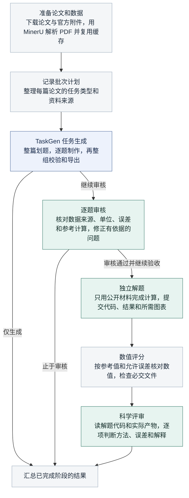
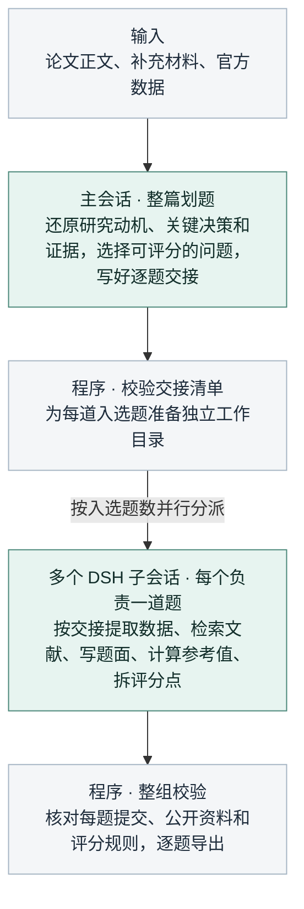

# 论文出题工作流与提示词

一篇物理论文先由一个主会话统一划分研究问题，再由 DeepSeek Harness（DSH，代理运行框架）为每道入选题启动一个独立子会话。**划题决定考什么，逐题抽取与制作决定给解题者什么、怎样评分。** 生成时，子代理会从公开数据计算评分参考值。独立解题属于后续验收，解题代理只拿到公开材料。

## 整体工作流

绿色节点使用模型，灰色节点由程序执行，蓝色节点包含两者。模型节点内写的是提示词的中文大意。

批次计划用于记录每篇论文的分类和资料来源。每道题的研究问题、用到的数据和评分目标由 TaskGen 主会话写入题目交接清单。批量入口支持 `--through build`（生成并导出）、`--through review`（继续逐题审核）和 `--through judge`（继续完整验收，默认）。第 10 篇的实际运行用的是 `--through build`。

## TaskGen 任务生成详解

### 1. 整篇划题的提示词

主会话负责读论文、选题和写 `task_series.json`（题目交接清单）。在写每道题的题面和计算参考值之前，先确定整组题的范围。

| 步骤                               | 提示词中文大意                                                                                                                                                                                         |
| ---------------------------------- | ------------------------------------------------------------------------------------------------------------------------------------------------------------------------------------------------------ |
| **还原研究主线** | 关联引言、方法、结果和补充材料，找出研究者当时知道什么、需要决定什么、用什么证据作判断。 |
| **选择能独立考查的决策** | 按论文选择假设、方法、测量或解释等问题，查清背景和可用输入能否支撑答题。只换粒子或时段的相同计算合到一题。 |
| **交接题面和评审依据** | 分开记录可以公开的起始材料、答题者要作的决定、应交的证据，以及私有的论文参考和评分点。开放题允许科学上合适的替代答案。 |

第 10 篇里，主会话把 **9 天和 13.5 天**两个固定周期的比较合进同一道题，因为两者用同样的拟合方法。另设一道找峰题，在 **6–60 天**的范围内寻找最突出的周期。两题复用同类拟合，交付的结论分别是「指定周期有多强」和「最突出的周期有多长」。

### 2. 逐题抽取与制作的提示词

清单定稿后，主会话调用 `build_task_series`（批量构建题包）。每个子代理收到共同的制题提示词，以及本题的编号、科研阶段、问题、证据、方法、关键输出和评分项名称。每个子代理只制作分到的题。第 10 篇实际启用了 **1 个主会话和 4 个并行子会话**。每个会话可多轮推理，也可调用工具读文件和运行计算。

| 步骤                             | 提示词中文大意                                                                                                                                                         |
| -------------------------------- | ---------------------------------------------------------------------------------------------------------------------------------------------------------------------- |
| **提取并整理输入**         | 按这道题的交接找到官方测量表，明确数据列、时间窗、分组、单位、缺测和误差处理方式。把独立作答所需的材料放进题包，记录数据来源。                                         |
| **检索相关工作**           | 围绕本题检索方法、背景或对照研究。随题提供至少一篇有用且可读的公开 PDF，记录检索词、文献来源和用途。目标论文和会直接给出本题答案的材料留在公开题包之外。               |
| **写题面和提交要求** | 交代所需背景与约束，说明答题者要作的决定、要交的证据。给定算法的复现题写明计算约定。 |
| **建立评分参考** | 计算题用同一份公开输入复算。定性题为每个关键判断写明依据、可接受的替代方案和适用边界。评分参考保存在私有区。 |
| **把评分拆成两层**         | 大项按科研目标分组，小项分别检查具体数值、方法、误差解释或图表。每个小项直接占整题的一部分分数，小项权重之和等于所属大项的权重。                                       |

以找峰题为例，主会话指定 **378 天、最低磁刚度区间、按 0.05 天间隔扫描 6–60 天**。每个候选周期都拟合一条含线性趋势的周期曲线，按测量误差加权。主会话将两处峰的位置及各自与振幅中位数的比值列为核心评分结果。子代理据此写明取数条件，把周期扫描表、标峰图和数值摘要列入提交要求，再从同一张公开表算出评分参考值。

子代理完成后先检查自己的题包。程序核对子会话的完成记录、各题的公开材料和评分权重，并确认交接指定的关键结果都有对应的数值或科学评审检查。整组校验通过后，程序逐题导出供解题使用的公开版本。

## 示例｜第 10 篇 AMS-02 日质子通量论文

这篇论文的官方数据包含 **2,824 个观测日、30 个磁刚度区间、83,757 条记录**。磁刚度描述带电粒子在磁场中被偏转的难易程度。用 `Sage-S2.1-Flash` 生成并导出四道题，用时约 **28 分 37 秒**。下表按本次交接清单的顺序列出题目。数值取自生成阶段保存的评分参考。

| 科研环节与题目                             | 从论文中抽出的计算和评分目标                                                                                                                                                                      |    随题 PDF |     评分大项 |     得分小项 |
| ------------------------------------------ | ------------------------------------------------------------------------------------------------------------------------------------------------------------------------------------------------- | ----------: | -----------: | -----------: |
| **测量 · 描述通量的总体波动**       | 用全时段数据计算各磁刚度区间的相对波动，即通量标准差除以平均通量。最低区间约 **45.65%**，最高区间约 **1.32%**。                                                                       |           2 |            4 |           12 |
| **比较 · 9 天和 13.5 天周期的强度** | 在前后各 189 天内比较固定周期的振幅。以 **5.90–6.47 GV** 为例，前半段的 9 天周期相对振幅约为后半段的 **3.02 倍**。                                                                   |           2 |            4 |           11 |
| **推断 · 寻找最突出的重复周期**     | 在最低磁刚度区间的 378 天数据上扫描 **6–60 天**的候选周期。最突出的两个峰在 **27.05 天**和 **13.55 天**。                                                                      |           3 |            3 |           11 |
| **稳健性检验 · 审计系统误差**       | 核查通量表中的误差列及论文给出的误差范围。参考计算中，总系统误差小于时变分量的记录数为 **0**。在刚度下界至少为 **2.15 GV** 的区间中，总系统误差相对通量的最大值约为 **1.53%**。 |           2 |            4 |           15 |
| **合计**                             | **4 道独立题目**。文献附件去重后为 **5 篇**。                                                                                                                                         | **9** | **15** | **49** |

### 两层评分示例

「寻找最突出的重复周期」一题有三个评分大项。以满分 100 分计，周期扫描方法及产物占 **30 分**，数值结果占 **45 分**，范围、局限和解释占 **25 分**。其中「数值结果」继续拆为四个小项。

| 大项                 | 小得分点                           | 占整题分数 |
| -------------------- | ---------------------------------- | ---------: |
| 数值结果（共 45 分） | 首要周期                           |      15 分 |
|                      | 次要周期                           |      10 分 |
|                      | 首峰振幅与扫描区间振幅中位数的比值 |      10 分 |
|                      | 次峰振幅与扫描区间振幅中位数的比值 |      10 分 |

完整验收时，程序根据参考值和允许误差核对这四项。比如首要周期答对、次要周期缺失，首要周期仍可得 15 分。科学评审根据解题代码和报告判断需要阅读证据的小项。程序最后汇总各小项得分。

第 10 篇的四道题均已通过生成阶段的程序校验并导出。校验逐题核对交付内容。约 27 天周期在不同年份和磁刚度下的变化，仍是这组题的覆盖缺口。
